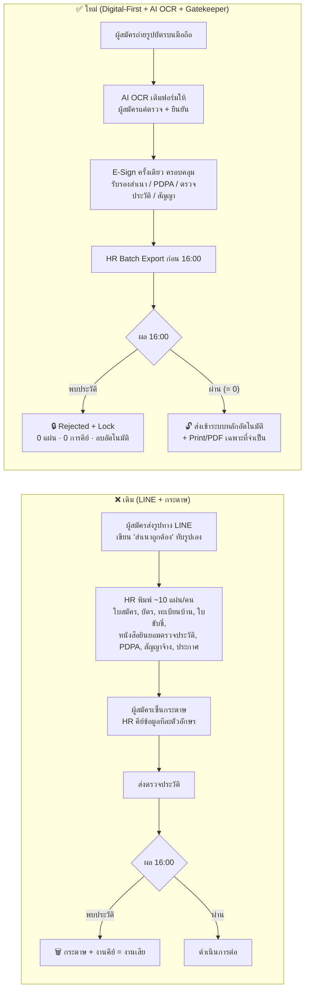
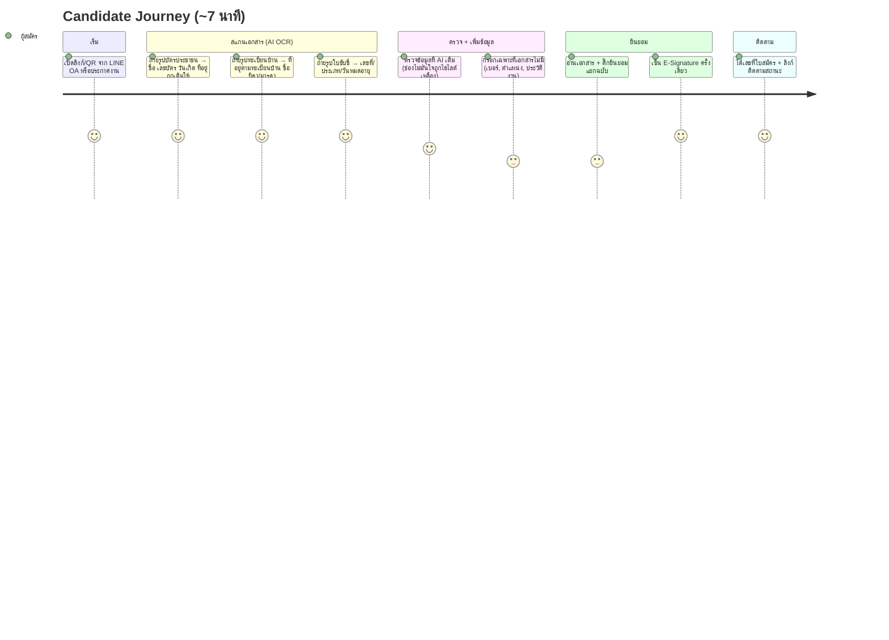
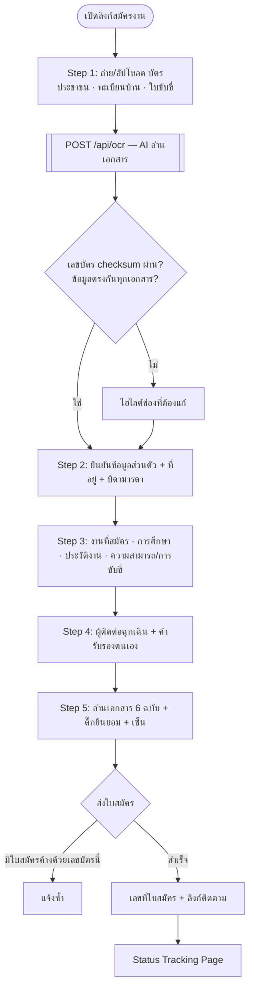
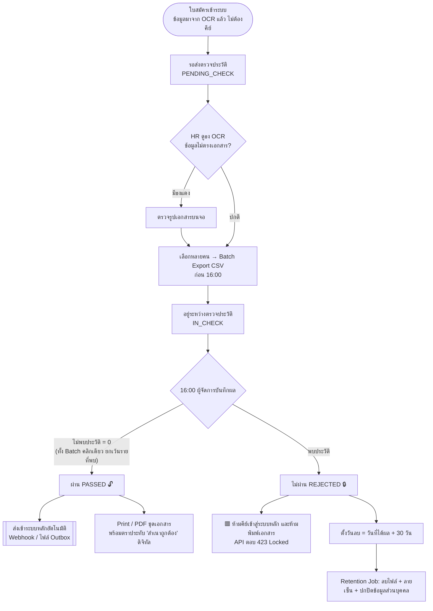
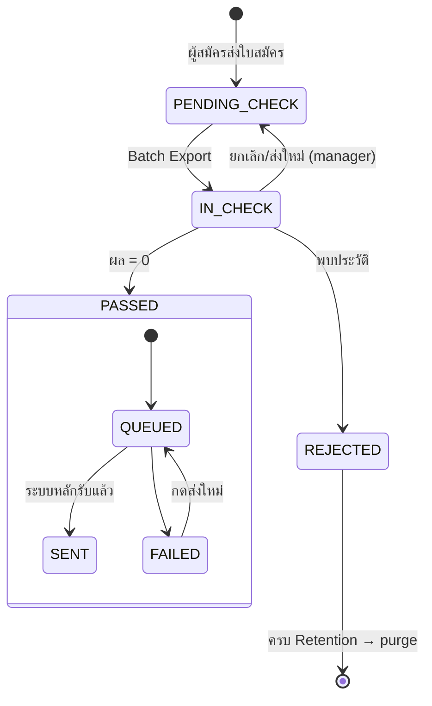

# 01 — User Journey & Workflow

> Smart Recruitment & OCR Portal — บริษัท สยามราชธานี จำกัด (มหาชน)
> หลักการ: **"AI อ่านเอกสารแทนคน → ตรวจประวัติก่อน → ค่อยลงแรงเฉพาะคนที่ผ่าน"**

## 1. เดิม vs ใหม่

## 2. User Journey — ผู้สมัคร (มือถือ)

## 3. Workflow — HR

### State machine

`main_sync_status` (QUEUED/SENT/FAILED) คือสถานะย่อยของ PASSED — ผู้สมัครที่ไม่ใช่ PASSED จะเป็น `NOT_ALLOWED` เสมอ

## 4. รอบการทำงานรายวัน

```mermaid
gantt
  dateFormat HH:mm
  axisFormat %H:%M
  title รอบการทำงานรายวัน
  section ผู้สมัคร
  สมัครออนไลน์ + AI OCR ตลอดวัน   :a1, 08:00, 7h
  section HR
  ตรวจธง OCR (บนจอ)               :b1, 08:30, 6h
  Batch Export (cut-off)           :crit, b2, 14:30, 30m
  ผลกลับ + บันทึกผล                :crit, b3, 16:00, 20m
  ระบบส่งเข้าระบบหลักอัตโนมัติ      :b4, 16:20, 10m
```

## 5. RBAC ตาม PDPA

| การกระทำ | staff (4 คน) | manager (1 คน) |
|---|:-:|:-:|
| ดูรายชื่อ + ข้อมูลพื้นฐาน (เลขบัตรแบบ `1-1004-xxxxx-xx-8`) | ✅ | ✅ |
| ดูเลขบัตรเต็ม / ชื่อบิดามารดา / คำรับรองตนเอง (สุขภาพ, คดี) | ❌ | ✅ |
| ดูรูปเอกสาร (ยกเว้นเคส Rejected) | ✅ | ✅ |
| Batch Export ส่งตรวจ | ✅ | ✅ |
| บันทึกผลตรวจประวัติ / ดูรายละเอียดคดี | ❌ | ✅ |
| ส่งเข้าระบบหลัก (ซ้ำ) / Print PDF — เฉพาะ PASSED | ✅ | ✅ |
| Audit Log / สั่ง Retention | ❌ | ✅ |

ทุกการเปิดเอกสาร, export, print, sync, บันทึกผล ถูกเก็บลง `audit_logs`
