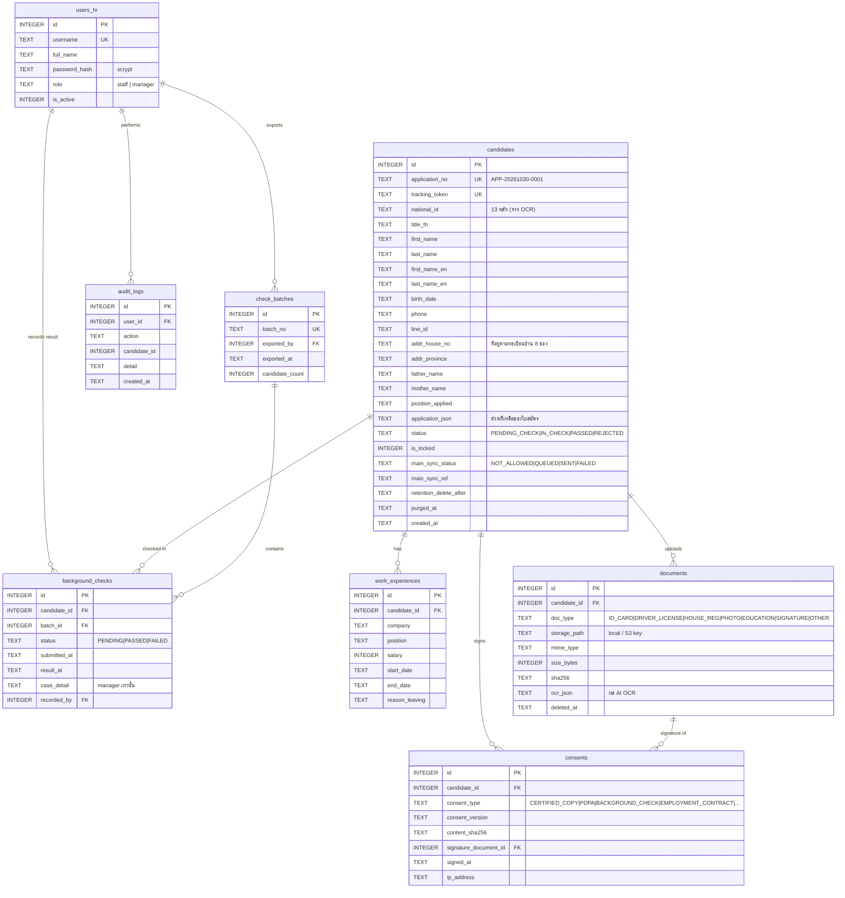

# 02 — Database Schema / ER Diagram

SQL จริง: [`db/schema.sql`](../db/schema.sql) — SQLite (ใช้ `node:sqlite` ไม่ต้องติดตั้ง DB) ย้ายไป PostgreSQL ได้โดยเปลี่ยน `INTEGER PRIMARY KEY` → `BIGSERIAL`, วันที่ `TEXT` → `TIMESTAMPTZ`, `application_json`/`ocr_json` → `JSONB`

จาก 4 ตารางในโจทย์ เพิ่ม 4 ตารางที่จำเป็นเมื่อใช้งานจริง:

| ตาราง | ทำไมต้องมี |
|---|---|
| `work_experiences` | ใบสมัครมี "บริษัทล่าสุด / ก่อนล่าสุด" — 1 คนหลายแถว |
| `consents` | 1 แถว/เอกสารที่เซ็น (รับรองสำเนา, PDPA, ตรวจประวัติ, สัญญาจ้าง, NDA/ข้อ 15, ประกาศ Tik Track) + hash ของข้อความที่ยินยอม = หลักฐานทางกฎหมาย |
| `check_batches` | รอบการส่งตรวจประวัติรายวัน (ใครส่ง ส่งกี่คน) |
| `audit_logs` | บันทึกการเข้าถึงข้อมูลส่วนบุคคล (PDPA ม.39) |

การออกแบบที่สำคัญ:

- **ข้อมูลที่ต้องค้นหา/ใช้ในหนังสือราชการเป็นคอลัมน์** (เลขบัตร, ชื่อ, ที่อยู่ตามทะเบียนบ้านแยกช่อง, ชื่อบิดา/มารดา — หนังสือยินยอมตรวจประวัติถึงกองทะเบียนประวัติอาชญากรต้องใช้) ส่วนที่เหลือของใบสมัครกระดาษ (การศึกษา, ทักษะ, การขับขี่, คำรับรองสุขภาพ) อยู่ใน `application_json`
- **`documents.ocr_json`** เก็บผล AI OCR ดิบ ที่ผูกกับ sha256 ของไฟล์นั้นจริง → HR เห็นได้ว่าผู้สมัครแก้ข้อมูลจากที่ AI อ่านหรือไม่
- **ลายเซ็น** เก็บเป็น PNG ใน `documents (doc_type='SIGNATURE')` และอ้างจาก `consents.signature_document_id` → ลบตาม Retention ด้วยกลไกเดียวกับเอกสารอื่น
- **`main_sync_status`** = Gatekeeper ระดับฐานข้อมูล: ค่าเริ่มต้น `NOT_ALLOWED` จะเปลี่ยนเป็น `QUEUED` ได้เฉพาะเมื่อผลตรวจ = ผ่าน

## Constraint ที่บังคับใช้

| สิ่งที่บังคับ | วิธี |
|---|---|
| เลขบัตรห้ามมีใบสมัครค้างซ้ำ | partial unique index `ux_candidates_active_nid` |
| สถานะอยู่ในชุดที่กำหนด | `CHECK (...)` |
| Gatekeeper | API ตรวจ `status = 'PASSED'` ก่อน sync / print — ตอบ HTTP 423 Locked |
| Retention | `retention_delete_after` ตั้งตอนบันทึก FAILED; job รายชั่วโมงลบไฟล์ + ปกปิด PII เหลือแค่สถิติ |

## เมื่อขึ้น Production

- เข้ารหัส `national_id` ระดับคอลัมน์ (AES-256-GCM) + เก็บ HMAC ไว้ค้นหาซ้ำ
- เก็บไฟล์ใน Object Storage แบบ private (S3 / Azure Blob / GCS) + signed URL อายุสั้น
- HTTPS เท่านั้น, backup เข้ารหัส, retention ของ backup ต้องสอดคล้องกัน
