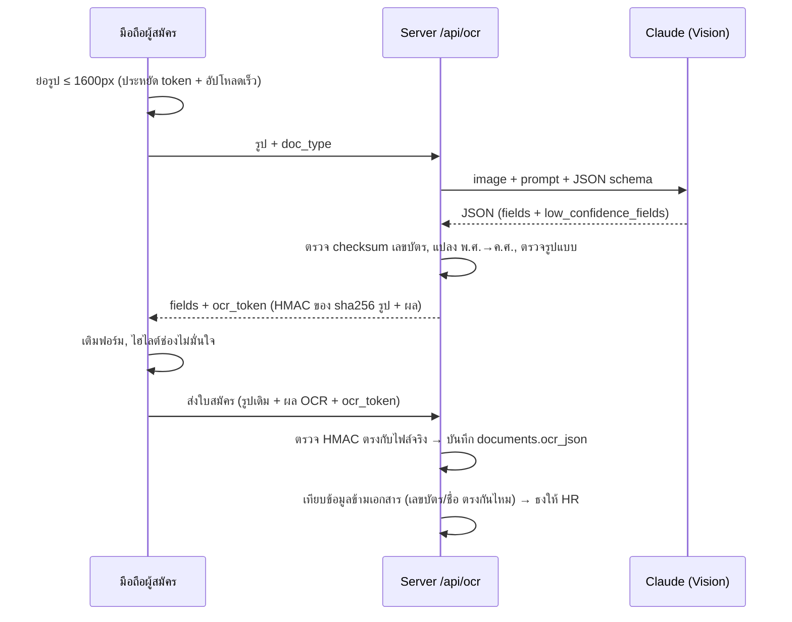

# 03 — AI OCR Design

โค้ด: [`src/ocr.js`](../src/ocr.js)

## ทำไมใช้ Vision LLM (Claude) แทน OCR แบบดั้งเดิม

เอกสารจริงจากผู้สมัครมีลักษณะที่ OCR ทั่วไป (Tesseract ฯลฯ) อ่านภาษาไทยได้ไม่ดี:

- มี **ลายมือ "ใช้เพื่อสมัครงาน… / สำเนาถูกต้อง" สีแดงเขียนทับ** ตัวอักษรบนบัตร
- ทะเบียนบ้านเป็น **สำเนาถ่ายเอกสารซีดจาง** มีลายมือแก้ไขที่อยู่
- วันที่เป็น **พ.ศ. ย่อเดือนไทย** (`30 ธ.ค. 2530`) ต้องแปลงเป็น ค.ศ.
- เลขบัตรเว้นวรรคต่างกัน (`1 1004 00307 96 8` / `1-1004-00307-96-8`)

Vision LLM อ่าน "ความหมาย" ของเอกสาร แยกข้อความที่ถูกเขียนทับออกได้ และคืนค่าเป็น JSON ตาม schema ทันที (Structured Outputs)

## Pipeline

`ocr_token` ทำให้ไม่ต้องเรียก AI ซ้ำตอนส่งใบสมัคร แต่ผู้สมัครก็ปลอมผล OCR ไม่ได้ เพราะ token ผูกกับไฟล์จริง

## ฟิลด์ที่ดึง

| เอกสาร | ฟิลด์ |
|---|---|
| บัตรประชาชน | เลข 13 หลัก, คำนำหน้า, ชื่อ-สกุล ไทย/อังกฤษ, วันเกิด, ที่อยู่ (แยก บ้านเลขที่/หมู่/ซอย/ถนน/ตำบล/อำเภอ/จังหวัด), วันออก/หมดอายุบัตร, ศาสนา |
| ทะเบียนบ้าน | รหัสประจำบ้าน, ที่อยู่, ชื่อเจ้าของรายการ, เลข 13 หลัก, ชื่อบิดา, ชื่อมารดา, เพศ, วันเกิด |
| ใบขับขี่ | เลขที่ใบอนุญาต, ประเภท (รถยนต์/จักรยานยนต์ ส่วนบุคคล/สาธารณะ), วันออก/หมดอายุ, ชื่อ, วันเกิด, เลข 13 หลัก |

## การตั้งค่า

| ตัวแปร | ค่า |
|---|---|
| `OCR_PROVIDER` | `claude` (ค่าเริ่มต้นเมื่อมี credential) · `mock` (ข้อมูลสมมติ ใช้ทดสอบ UI โดยไม่เสียค่า API) · `off` |
| `ANTHROPIC_API_KEY` | API key จาก console.anthropic.com |
| `OCR_MODEL` | ค่าเริ่มต้น `claude-opus-5-5` |

ประมาณการค่าใช้จ่าย: รูปที่ย่อแล้ว ~1,600 input tokens + output ~600 tokens ต่อเอกสาร → ประมาณ **$0.02/เอกสาร** · 10 คน/วัน × 3 เอกสาร ≈ **$0.6/วัน** (ถูกกว่ากระดาษ 100 แผ่น + เวลาคีย์ของ HR อย่างมาก)

## PDPA — ข้อควรทำก่อนใช้งานจริง

1. การส่งรูปบัตรไปประมวลผลที่ผู้ให้บริการ AI = **การโอนข้อมูลไปต่างประเทศ / ใช้ผู้ประมวลผลข้อมูล** → ต้องระบุใน Privacy Notice + PDPA consent (มีข้อความรองรับไว้แล้วใน `src/consentTemplates.js`) และทำ DPA กับผู้ให้บริการ
2. ตั้งค่า Zero Data Retention กับผู้ให้บริการ AI ถ้าองค์กรมีสิทธิ์
3. ทางเลือก on-premise ถ้านโยบายไม่อนุญาตส่งออก: PaddleOCR (รองรับไทย) + regex parser — เปลี่ยนได้ที่ฟังก์ชัน `extractDocument()` ฟังก์ชันเดียว
